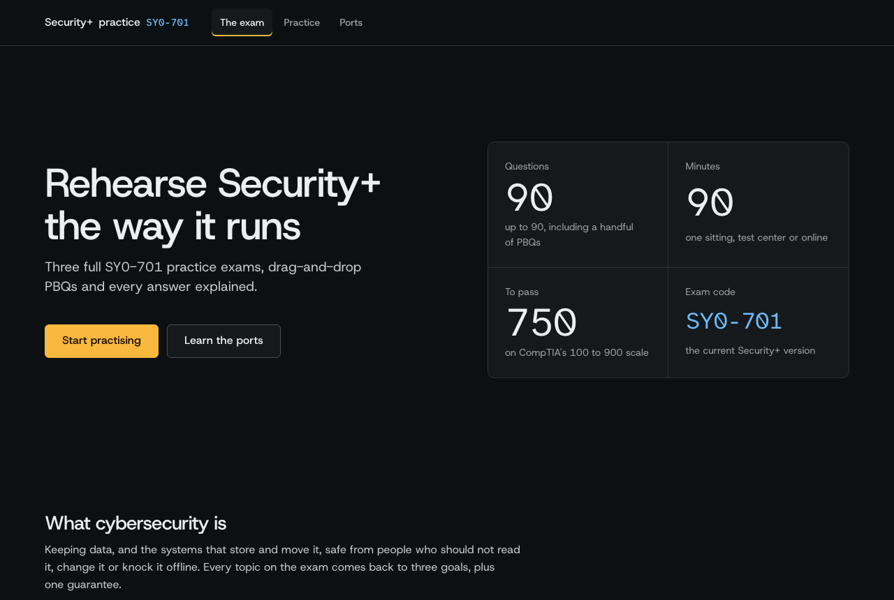
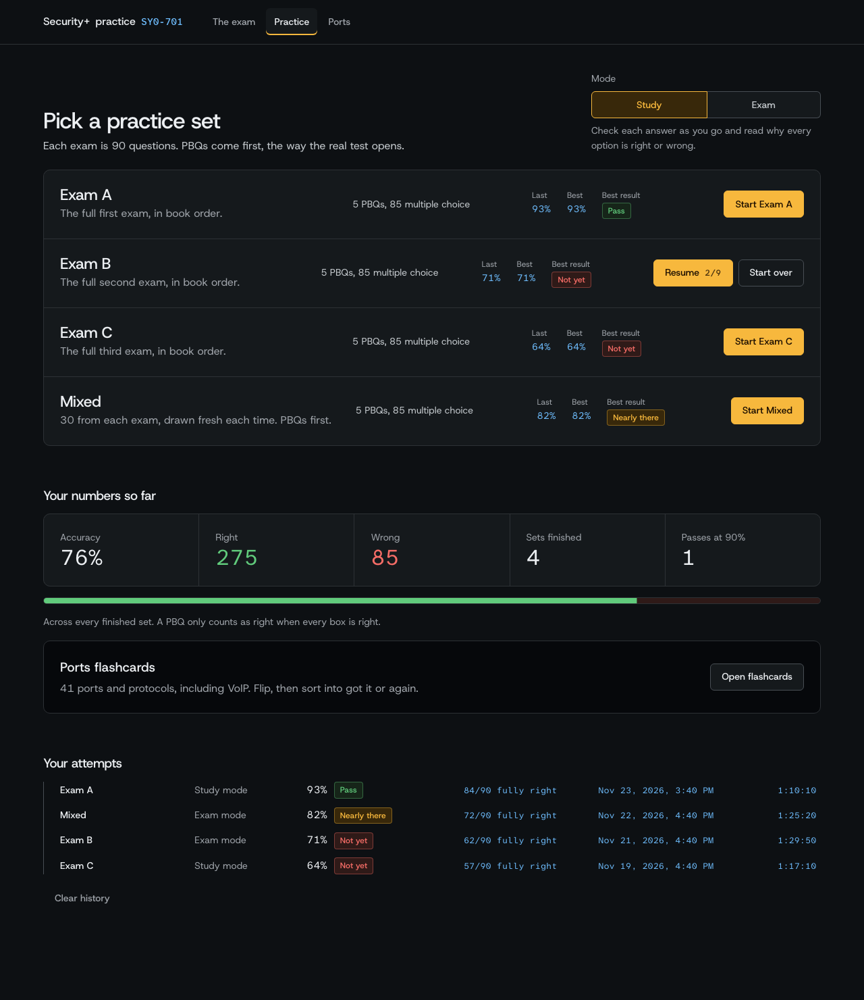
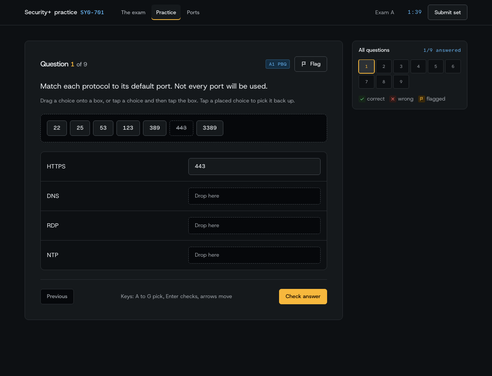
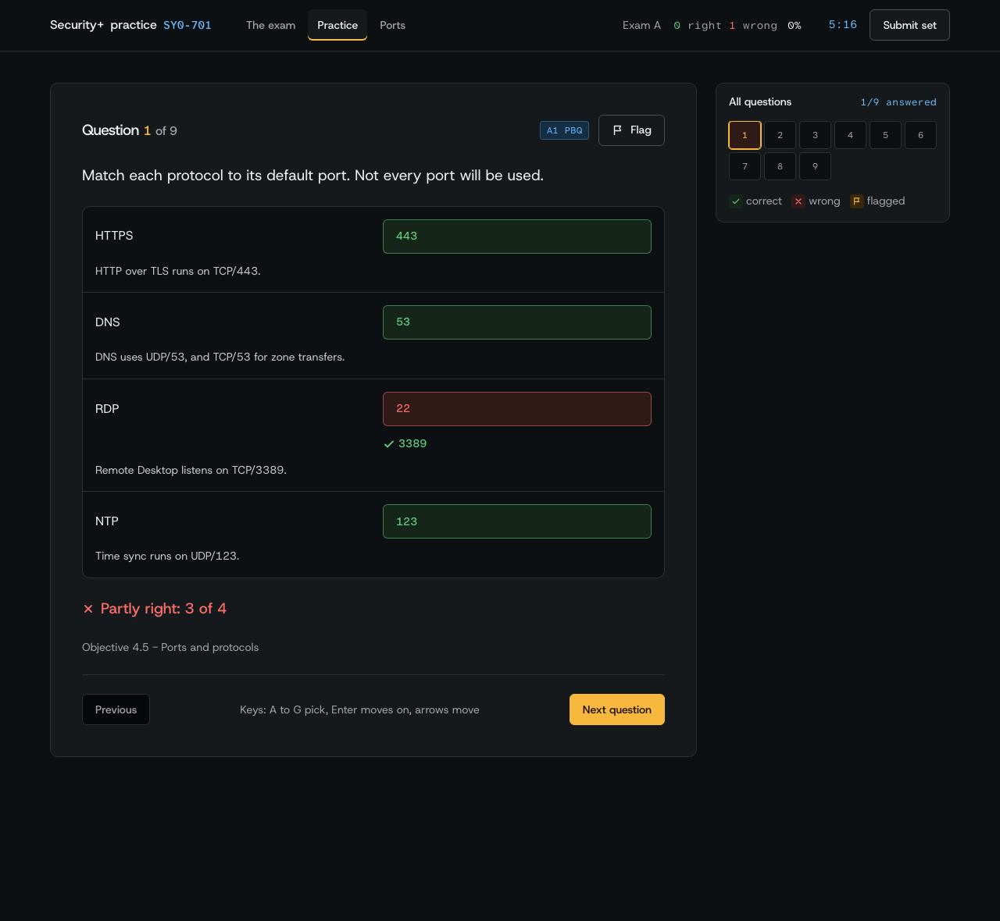
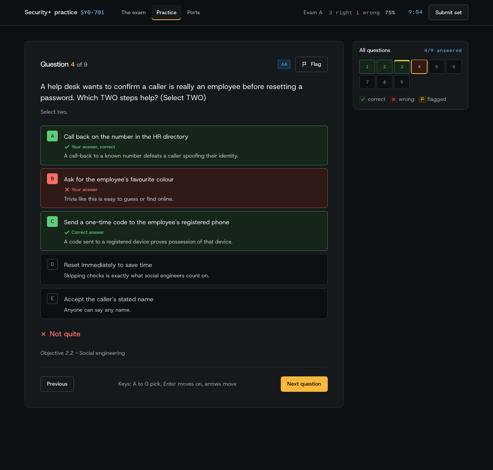
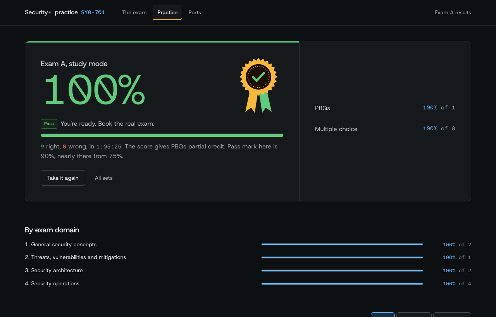
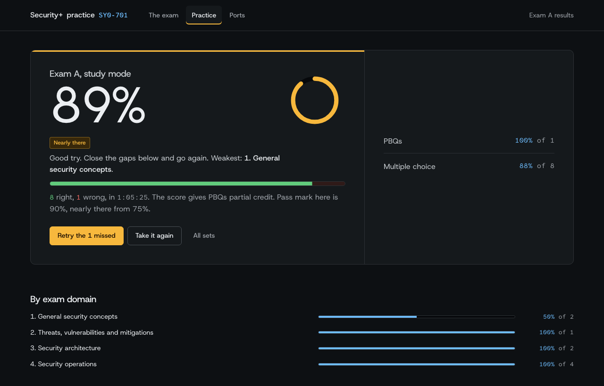
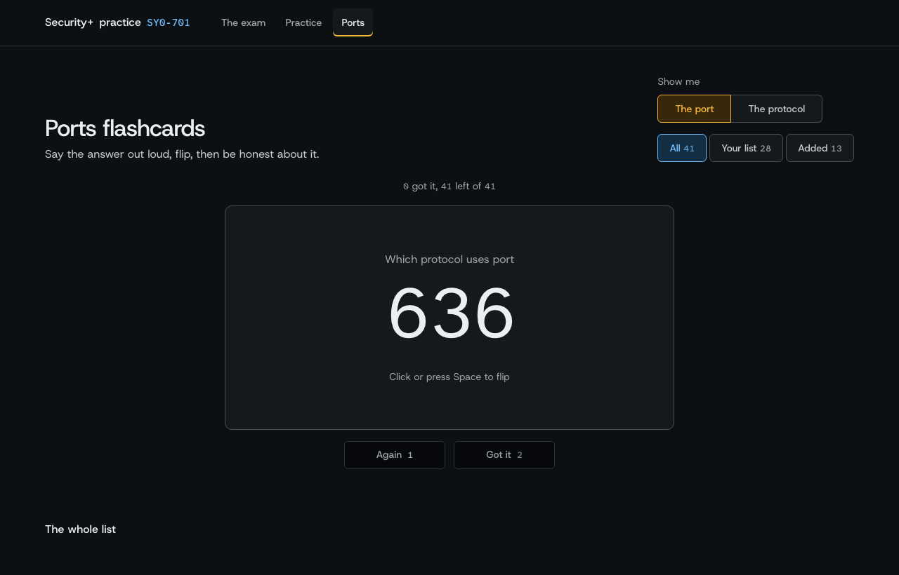
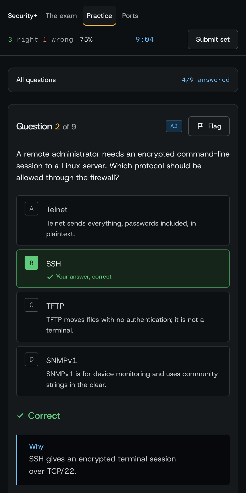

# Security+ SY0-701 practice exam

A local study site for the CompTIA Security+ SY0-701 exam. It runs from `index.html` with no server and no install.



- **Exams A, B and C:** 90 questions each, performance-based questions (PBQs) first, the way the real exam opens.
- **Mixed:** 30 questions from each exam, drawn fresh every time you start.
- **Study or exam mode:** check each answer as you go, or work against a 90-minute clock and review at the end.
- **Every option explained:** why the right answer is right, why each wrong one is wrong, and a link to the objective's video.
- **Drag-and-drop PBQs:** drag, or tap a choice and then tap a box. There's also a firewall-rule table.
- **Scores:** 90% and up is a pass, 75 to 89% is nearly there, and below 75% means read more. You also get a breakdown by domain, right and wrong totals across all attempts, and a retry of the questions you missed.
- **Ports flashcards:** 41 ports and protocols, VoIP included.

Progress is saved in your browser's localStorage.

## Screenshots

The screenshots use sample questions written for this README. The book's questions are not shown.

**Pick a set, and see your numbers across every attempt**



**Drag-and-drop PBQs, then the marked result with a note on each box**

| Answering | Checked |
| --- | --- |
|  |  |

**Multiple choice, with the reason behind every option**



**Results: pass ribbon at 90%, nearly there from 75%**

| Pass | Nearly there |
| --- | --- |
|  |  |

**Ports flashcards, and it works on a phone**

| Flashcards | Phone |
| --- | --- |
|  |  |

## Building the question data

The questions come from **Professor Messer's SY0-701 CompTIA Security+ Practice Exams**, which is copyrighted. They are not in this repository. Build them from your own copy:

```bash
pip3 install pymupdf
python3 tools/build.py path/to/professor-messer-sy0-701-comptia-security-plus-practice-exams.pdf
```

That writes `data.js` (the 255 multiple-choice questions). The PBQs are hand-encoded in `pbq.js`, which is kept local for the same reason. Without it, the exams run with multiple choice only.

Then open `index.html` in Chrome, Safari, Firefox or Edge.

## Sources

- Questions and explanations: Professor Messer, SY0-701 Practice Exams ([professormesser.com](https://www.professormesser.com)). Get the book from him.
- Exam facts and tips on the landing page: Dion Training, SY0-701 Study Notes ([diontraining.com](https://www.diontraining.com)).

This is a personal study tool. It is not affiliated with CompTIA, Professor Messer or Dion Training.
